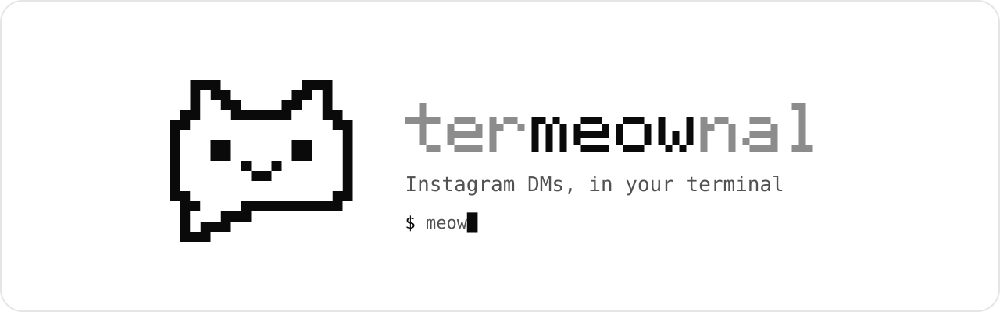
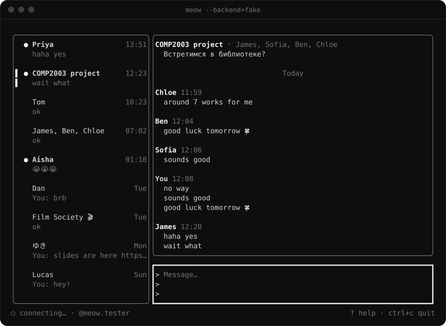
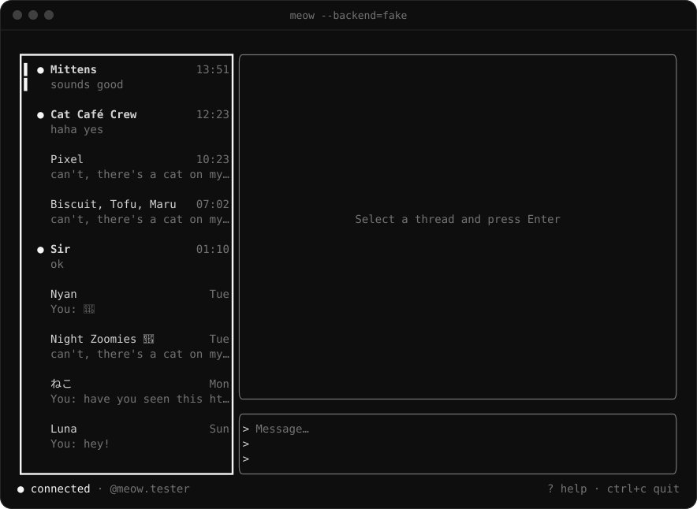
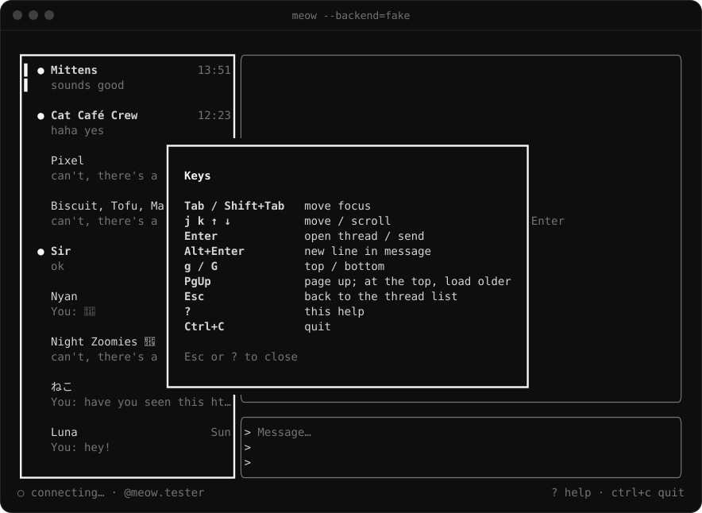
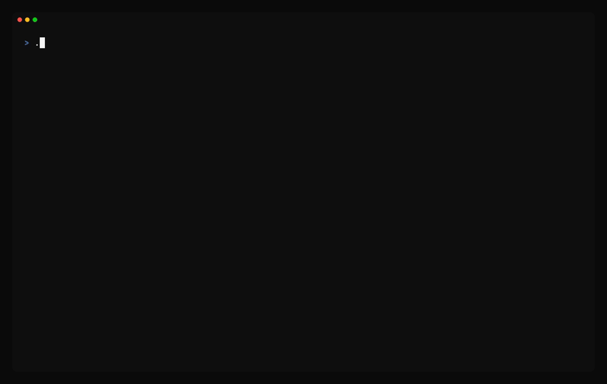
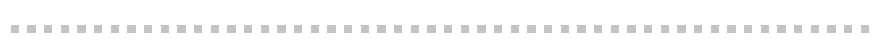

<p align="center">
  <picture>
    <source media="(prefers-color-scheme: dark)" srcset="assets/banner-dark.svg">
    
  </picture>
</p>

<p align="center">
  <a href="https://github.com/ericliswan/termeownal/actions/workflows/ci.yml"></a>
  
  <a href="LICENSE"></a>
  <a href="ROADMAP.md#14-milestones"></a>
</p>

<p align="center">
  <a href="#preview">Preview</a> ·
  <a href="#features">Features</a> ·
  <a href="#building">Building</a> ·
  <a href="#logging-in">Logging in</a> ·
  <a href="#configuration">Configuration</a> ·
  <a href="#contributing">Contributing</a> ·
  <a href="ROADMAP.md">Roadmap</a>
</p>

Instagram DMs in your terminal. Log in once, see your threads, read history, send messages and get new ones live, all from one Go binary called **`meow`**.

termeownal talks to Instagram through [`instameow`](https://github.com/mautrix/meta/tree/main/pkg/instameow), the Instagram client library inside the [mautrix/meta](https://github.com/mautrix/meta) bridge. It doesn't run the bridge, Matrix or any server.

> **Status: early development.** termeownal works with a real account: it loads your threads and history, and sends and receives messages live. The rest of the MVP is being built now; see [Features](#features) for what's missing. Progress is tracked in [`ROADMAP.md`](ROADMAP.md#14-milestones).

## Preview

<p align="center">
  
</p>
<p align="center"><sub>The UI so far, running with <code>--backend=fake</code>: canned chats, no network.</sub></p>

<p align="center">
  
  
</p>
<p align="center"><sub>The thread list, and the key help you get with <code>?</code></sub></p>

<!--
  Demo GIF: once the app is further along, run `make demo` (needs vhs) to
  record docs/demo.tape into assets/demo.gif, then swap the image above for:

  
-->

<p align="center"></p>

## ⚠️ Read this first

- **This is an unofficial client.** Instagram's terms don't allow third-party clients. Using one can get your account flagged, checkpointed or locked. Try it with a secondary account first, at your own risk.
- **End-to-end encrypted chats aren't supported.** The upstream library can't read them.
- termeownal isn't affiliated with or endorsed by Instagram or Meta.

## Features

**Works now**
- Cookie login (`meow login`) and `meow logout`
- A thread list, a chat view and a composer, with Vim-style keys
- Your threads and their history, with older messages loaded as you scroll up
- Sending, and live incoming messages, renames and new threads
- Unread markers that clear when you read a thread on another device
- Instant startup from a local cache

**Still to come in the MVP**
- Showing a sent message right away, with a retry if it fails (until then it appears once Instagram confirms it)
- Marking a thread read when you open it
- Reconnecting on its own after the connection drops (until then, restart `meow`)

**Later:** replies, reactions, edits and unsends, typing indicators, read receipts, new DMs and message requests, media (opened externally or shown inline on kitty, iTerm2 or sixel), notifications, themes, and an optional password login.

## Building

You need [Go](https://go.dev/dl/) 1.26 or newer and Git. termeownal is pure Go, so you don't need a C compiler. First, get the code:

```sh
git clone https://github.com/ericliswan/termeownal.git
cd termeownal
```

Then build it and try the UI without an account, with canned chats and no network.

**macOS, Linux and other Unix-like systems:**

```sh
make static        # builds bin/meow
./bin/meow --backend=fake
```

Without `make`, build with `CGO_ENABLED=0 go build -o bin/meow ./cmd/meow`.

**Windows** (PowerShell, ideally in [Windows Terminal](https://aka.ms/terminal)):

```powershell
go build -o bin\meow.exe .\cmd\meow
.\bin\meow.exe --backend=fake
```

The rest of this README writes `./bin/meow`; on Windows, type `.\bin\meow.exe` instead.

termeownal has been used with a real account only on macOS so far. CI runs the tests on Linux and checks that it builds for Windows. If something doesn't work on your system, please [open an issue](https://github.com/ericliswan/termeownal/issues).

Prebuilt releases and a Homebrew tap are planned for later.

## Logging in

termeownal logs in with cookies copied from your browser; it never asks for your password.

1. In a Chromium-based browser (Chrome, Edge or Brave), open a private window and log in to instagram.com.
2. Open DevTools (<kbd>F12</kbd> or <kbd>Ctrl</kbd>+<kbd>Shift</kbd>+<kbd>I</kbd>; <kbd>Cmd</kbd>+<kbd>Opt</kbd>+<kbd>I</kbd> on a Mac), click the **Network** tab and reload the page.
3. Right-click the first request (`www.instagram.com`) and choose **Copy → Copy as cURL**. On Windows, pick **Copy as cURL (bash)**, not the `cmd` or PowerShell versions.
4. Run `./bin/meow login` and paste. Nothing is shown as you paste; press <kbd>Enter</kbd>. A JSON object of cookie names and values works too, or press <kbd>Enter</kbd> on an empty answer to type each cookie.
5. Close the private window **without logging out**: logging out ends the session you just copied.
6. Run `./bin/meow`. The first start loads everything from Instagram; later ones show your cached threads straight away.

Press <kbd>?</kbd> in `meow` for the keys. If the session expires, `meow` asks you to run `meow login` again. `meow logout` deletes the saved session and its key; `meow logout --purge` deletes the message cache too.

## Where your data lives

| What | File | Notes |
|---|---|---|
| Settings | `config.toml` | Optional |
| Log | `meow.log` | Readable only by you; never holds passwords, cookies or message text |
| Session | `session.enc` | Encrypted; the key is kept in your OS keyring |
| Message cache | `cache.db` | **Plaintext** on disk, so it can be deleted and fetched again |

| System | Settings | Session and cache | Log |
|---|---|---|---|
| macOS | `~/Library/Application Support/termeownal` | same | same |
| Linux and other Unix-like systems | `~/.config/termeownal` | `~/.local/share/termeownal` | `~/.local/state/termeownal` |
| Windows | `%LOCALAPPDATA%\termeownal` | same | same |

You can move them with the `XDG_CONFIG_HOME`, `XDG_DATA_HOME` and `XDG_STATE_HOME` environment variables, on every system.

The keyring is the macOS Keychain, the Windows Credential Manager, or on Linux the Secret Service (GNOME Keyring or KWallet). If there isn't one, `meow login` asks for a passphrase to encrypt the session with instead, and `meow` asks for it each time it starts.

termeownal never takes passwords or cookies from command-line flags or environment variables. It reads them from the terminal with echo turned off.

## Configuration

Every setting is optional. An unknown key or a bad value stops `meow` with an error that names the file.

```toml
# debug, info, warn or error
log_level = "info"

# How often to do a full reconnect. "0" turns it off; otherwise at least "1h".
force_refresh_interval = "20h"
```

## Development

| Task | Command |
|---|---|
| Every check run before a commit (gofmt, vet, race tests, lint) | `make check` |
| Run the tests | `go test ./...` |
| Lint | `golangci-lint run` |
| Record the README demo GIF (needs [vhs](https://github.com/charmbracelet/vhs)) | `make demo` |

The tests never contact Instagram.

The architecture and coding rules are in [`AGENTS.md`](AGENTS.md); the full plan and the reasoning behind it are in [`ROADMAP.md`](ROADMAP.md).

## Contributing

Contributions are welcome. Open an issue first for anything bigger than a small fix, so we can agree on the approach. Then send a pull request from a fork:

- Follow the rules in [`AGENTS.md`](AGENTS.md); they apply to people as well as coding agents. Above all: never commit cookies, session files or real Instagram data, and keep tests off the network.
- Run `make check` before you push; CI runs the same checks.
- Keep commits small, with a subject like `store: add thread ID mapping table`.

By contributing, you agree that your work is licensed under the [AGPL-3.0](LICENSE).

<p align="center"></p>

## Credits

termeownal is built on [mautrix/meta](https://github.com/mautrix/meta) by Tulir Asokan and its contributors. The terminal UI uses [Bubble Tea](https://github.com/charmbracelet/bubbletea).

## License

[AGPL-3.0](LICENSE). termeownal imports AGPL-licensed code from mautrix/meta, so it uses the same license.

<p align="center"></p>
