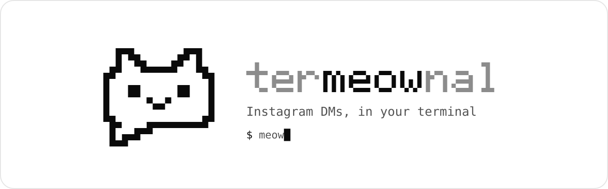
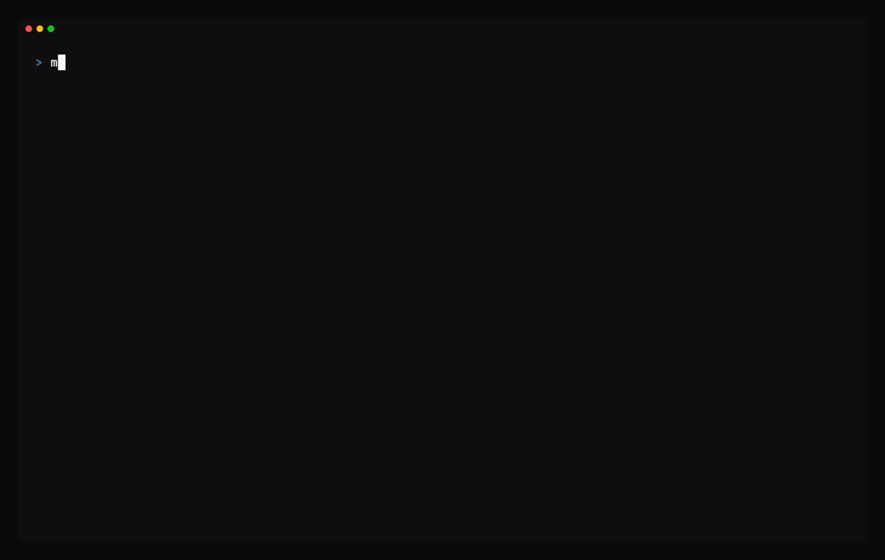
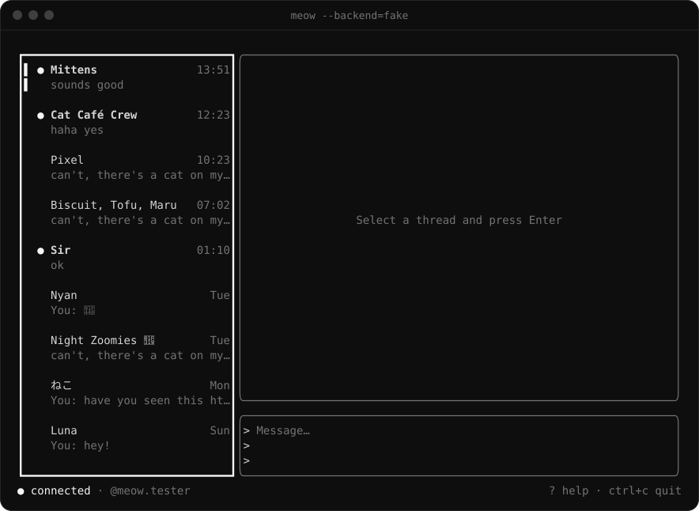
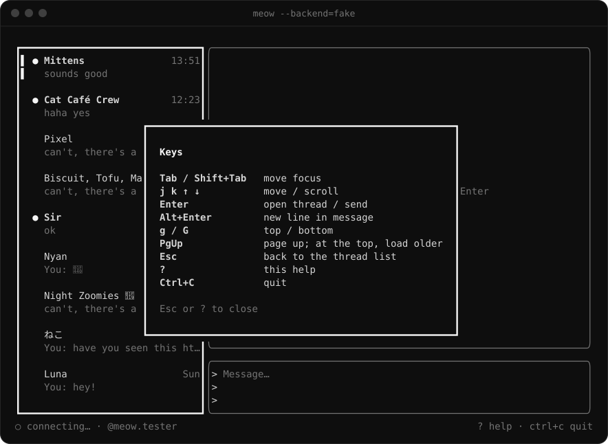
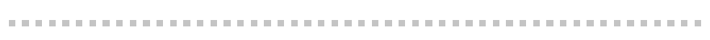

<p align="center">
  <picture>
    <source media="(prefers-color-scheme: dark)" srcset="assets/banner-dark.svg">
    
  </picture>
</p>

<p align="center">
  <a href="https://github.com/ericliswan/termeownal/actions/workflows/ci.yml"></a>
  
  <a href="LICENSE"></a>
  <a href="ROADMAP.md#14-milestones"></a>
</p>

<p align="center">
  <a href="#preview">Preview</a> ·
  <a href="#features">Features</a> ·
  <a href="#installing">Installing</a> ·
  <a href="#logging-in">Logging in</a> ·
  <a href="#configuration">Configuration</a> ·
  <a href="#contributing">Contributing</a> ·
  <a href="ROADMAP.md">Roadmap</a>
</p>

Instagram DMs in your terminal. Log in once, see your threads, read history, send messages and get new ones live, all from one Go binary called **`meow`**.

termeownal talks to Instagram through [`instameow`](https://github.com/mautrix/meta/tree/main/pkg/instameow), the Instagram client library inside the [mautrix/meta](https://github.com/mautrix/meta) bridge. It doesn't run the bridge, Matrix or any server.

> **Status: early development.** termeownal works with a real account: it loads your threads and history, and sends and receives messages live, with replies, reactions, edits and unsends. Media and more come next; see [Features](#features). Progress is tracked in [`ROADMAP.md`](ROADMAP.md#14-milestones).

## Preview

<p align="center">
  
</p>
<p align="center"><sub>The UI so far, running with <code>--backend=fake</code>: canned chats, no network.</sub></p>

<p align="center">
  
  
</p>
<p align="center"><sub>The thread list, and the key help you get with <code>?</code></sub></p>

<p align="center"></p>

## ⚠️ Read this first

- **This is an unofficial client.** Instagram's terms don't allow third-party clients. Using one can get your account flagged, checkpointed or locked. Try it with a secondary account first, at your own risk.
- **End-to-end encrypted chats aren't supported.** The upstream library can't read them.
- termeownal isn't affiliated with or endorsed by Instagram or Meta.

## Features

**Works now**
- `meow login` with a username and password (best effort) or cookies from a browser, and `meow logout`
- A thread list, a chat view and a composer, with Vim-style keys
- Your threads and their history, with older messages loaded as you scroll up
- Sending, and live incoming messages, renames and new threads
- Sent messages show right away, with a retry (`r`) if one fails
- Replies: select a message with `j`/`k` and press `r`; quoted replies show above the message
- Reactions under each message; select one and press `e` to react, searching by name like `:joy:`
- Edits and unsends: select your message and press `E` to edit it or `d` to unsend it; others' show as "(edited)" and "message unsent"
- "Seen" under your newest message once the other side has read it
- Typing indicators both ways; set `send_typing = false` to stop sending yours
- Emoji by name, as in Discord: type `:heart:` for ❤️, or pick from the matches shown after `:he`
- Muting a thread with `m` in the thread list: muted threads are dimmed and never notify
- Desktop notifications for messages in threads you aren't looking at; set `notify = false` to turn them off, or `notify_preview = false` to show only the sender
- Unread markers; opening a thread marks it read, here and on Instagram (only while the terminal is focused)
- Instant startup from a local cache
- Reconnecting on its own after the connection drops or the computer sleeps

**Next:** new DMs and message requests, media (opened externally or shown inline on kitty, iTerm2 or sixel) and themes.

## Installing

There are builds for macOS, Linux and Windows, on amd64 (Intel and AMD) and arm64 (Apple silicon and other ARM chips). Pick your system below. Then [log in](#logging-in), or try the UI without an account, with canned chats and no network: `meow --backend=fake`.

### macOS

With [Homebrew](https://brew.sh):

```sh
brew install ericliswan/tap/meow
meow --version   # check it worked
```

<details>
<summary>Don't have Homebrew?</summary>

Install it by pasting this into Terminal:

```sh
/bin/bash -c "$(curl -fsSL https://raw.githubusercontent.com/Homebrew/install/HEAD/install.sh)"
```

When it finishes, it prints a **Next steps** section with one or two commands that put `brew` on your `PATH`. Run those, open a new Terminal window, then run the `brew install` above.

</details>

### Linux

Homebrew works on Linux too: install it as above (its installer says which system packages it needs first), then `brew install ericliswan/tap/meow`. Or [download the binary](#downloading-the-binary-yourself).

### Windows (experimental)

meow hasn't been used with a real account on Windows yet. If something doesn't work, please [open an issue](https://github.com/ericliswan/termeownal/issues). Use [Windows Terminal](https://aka.ms/terminal), which comes with Windows 11; the older console window may draw the UI wrongly.

With [Scoop](https://scoop.sh), in PowerShell:

```powershell
scoop install git   # Scoop needs Git to add a bucket; skip if you have it
scoop bucket add ericliswan https://github.com/ericliswan/scoop-bucket
scoop install meow
meow --version      # check it worked
```

<details>
<summary>Don't have Scoop?</summary>

Open PowerShell as yourself (not as administrator) and run:

```powershell
Set-ExecutionPolicy -ExecutionPolicy RemoteSigned -Scope CurrentUser
Invoke-RestMethod -Uri https://get.scoop.sh | Invoke-Expression
```

The first line lets PowerShell run Scoop's installer script; answer `Y` if it asks. Then run the commands above.

</details>

Desktop notifications on Windows only work in a terminal that shows them itself.

### Downloading the binary yourself

Download the archive for your system from the [latest release](https://github.com/ericliswan/termeownal/releases/latest). Its name says the system and the chip:

| System | Chip | Archive |
|---|---|---|
| macOS | Apple silicon (M1 and later) | `meow_<version>_darwin_arm64.tar.gz` |
| macOS | Intel | `meow_<version>_darwin_amd64.tar.gz` |
| Linux | x86-64 | `meow_<version>_linux_amd64.tar.gz` |
| Linux | ARM64 (e.g. Raspberry Pi 4 and later, 64-bit OS) | `meow_<version>_linux_arm64.tar.gz` |
| Windows | x64 (most PCs) | `meow_<version>_windows_amd64.zip` |
| Windows | ARM (e.g. Snapdragon laptops) | `meow_<version>_windows_arm64.zip` |

macOS and Linux also have a `.zip` of each, with the same contents. Not sure which chip you have? On macOS or Linux, run `uname -m`: `arm64` or `aarch64` means arm64, `x86_64` means amd64. On Windows, run `$env:PROCESSOR_ARCHITECTURE` in PowerShell: `AMD64` or `ARM64`.

**macOS and Linux**, in a terminal, in the folder you downloaded to:

```sh
tar -xzf meow_*_darwin_arm64.tar.gz      # use the name of the file you downloaded
xattr -d com.apple.quarantine meow       # macOS, downloaded with a browser: the binary isn't signed
sudo mkdir -p /usr/local/bin
sudo mv meow /usr/local/bin/
meow --version
```

**Windows**, in PowerShell, in the folder you downloaded to:

```powershell
Expand-Archive meow_*_windows_amd64.zip -DestinationPath meow   # use the name of the file you downloaded
Unblock-File meow\meow.exe   # the binary isn't signed; this stops SmartScreen warning about it
$dir = "$env:LOCALAPPDATA\Programs\meow"
New-Item -ItemType Directory -Force $dir | Out-Null
Move-Item -Force meow\meow.exe $dir
[Environment]::SetEnvironmentVariable("Path", [Environment]::GetEnvironmentVariable("Path", "User") + ";$dir", "User")
```

Then open a new terminal, so it sees the new `Path`, and run `meow --version`. If you start `meow.exe` from File Explorer instead and SmartScreen says "Windows protected your PC", choose **More info → Run anyway**.

### Updating

| Installed with | Update with |
|---|---|
| Homebrew | `brew upgrade meow` |
| Scoop | `scoop update meow` |
| a download | download the new archive and repeat the steps above |

Your login and cache are kept.

### Uninstalling

First run `meow logout --purge`, which deletes your saved session, its key in the OS keyring, and the message cache. Then:

| Installed with | Remove with |
|---|---|
| Homebrew | `brew uninstall meow` |
| Scoop | `scoop uninstall meow` |
| a download | delete the `meow` binary (`/usr/local/bin/meow`, or `%LOCALAPPDATA%\Programs\meow` on Windows) |

`config.toml` and `meow.log` stay behind; [Where your data lives](#where-your-data-lives) says where they are.

## Building

To build from source instead, you need [Go](https://go.dev/dl/) 1.26 or newer and Git. termeownal is pure Go, so you don't need a C compiler. First, get the code:

```sh
git clone https://github.com/ericliswan/termeownal.git
cd termeownal
```

Then build it and try the UI without an account, with canned chats and no network.

**macOS, Linux and other Unix-like systems:**

```sh
make static        # builds bin/meow
./bin/meow --backend=fake
```

Without `make`, build with `CGO_ENABLED=0 go build -o bin/meow ./cmd/meow`.

**Windows** (PowerShell, ideally in [Windows Terminal](https://aka.ms/terminal)):

```powershell
go build -o bin\meow.exe .\cmd\meow
.\bin\meow.exe --backend=fake
```

The rest of this README writes `meow`; type `./bin/meow` if you built it yourself, or `.\bin\meow.exe` on Windows.

termeownal has been used with a real account only on macOS so far. CI runs the tests on Linux and checks that it builds for Windows. If something doesn't work on your system, please [open an issue](https://github.com/ericliswan/termeownal/issues).

## Logging in

Run `meow login` and choose how to log in.

**Username and password.** Type them, then a code if your account uses two-factor authentication, or approve the login in the Instagram app if it asks. meow saves only the session Instagram returns, never the password. Instagram sometimes wants a check only a browser can do, such as a CAPTCHA; `meow login` then stops and says so, and logging in with cookies works instead.

**Cookies from a browser.** This works even when Instagram asks for checks a terminal can't show.

1. In a Chromium-based browser (Chrome, Edge or Brave), open a private window and log in to instagram.com.
2. Open DevTools (<kbd>F12</kbd> or <kbd>Ctrl</kbd>+<kbd>Shift</kbd>+<kbd>I</kbd>; <kbd>Cmd</kbd>+<kbd>Opt</kbd>+<kbd>I</kbd> on a Mac), click the **Network** tab and reload the page.
3. Right-click the first request (`www.instagram.com`) and choose **Copy → Copy as cURL**. On Windows, pick **Copy as cURL (bash)**, not the `cmd` or PowerShell versions.
4. Run `meow login`, choose **Cookies from a browser**, and paste. Nothing is shown as you paste; press <kbd>Enter</kbd>. A JSON object of cookie names and values works too, or press <kbd>Enter</kbd> on an empty answer to type each cookie.
5. Close the private window **without logging out**: logging out ends the session you just copied.

Then run `meow`. The first start loads everything from Instagram; later ones show your cached threads straight away.

Press <kbd>?</kbd> in `meow` for the keys. If the session expires, `meow` asks you to run `meow login` again. `meow logout` deletes the saved session and its key; `meow logout --purge` deletes the message cache too.

## Where your data lives

| What | File | Notes |
|---|---|---|
| Settings | `config.toml` | Optional |
| Log | `meow.log` | Readable only by you; never holds passwords, cookies or message text |
| Session | `session.enc` | Encrypted; the key is kept in your OS keyring |
| Message cache | `cache.db` | **Plaintext** on disk, so it can be deleted and fetched again |

| System | Settings | Session and cache | Log |
|---|---|---|---|
| macOS | `~/Library/Application Support/termeownal` | same | same |
| Linux and other Unix-like systems | `~/.config/termeownal` | `~/.local/share/termeownal` | `~/.local/state/termeownal` |
| Windows | `%LOCALAPPDATA%\termeownal` | same | same |

You can move them with the `XDG_CONFIG_HOME`, `XDG_DATA_HOME` and `XDG_STATE_HOME` environment variables, on every system.

The keyring is the macOS Keychain, the Windows Credential Manager, or on Linux the Secret Service (GNOME Keyring or KWallet). If there isn't one, `meow login` asks for a passphrase to encrypt the session with instead, and `meow` asks for it each time it starts.

termeownal never takes passwords or cookies from command-line flags or environment variables. It reads them from the terminal with echo turned off.

## Configuration

Every setting is optional. An unknown key or a bad value stops `meow` with an error that names the file.

```toml
# debug, info, warn or error
log_level = "info"

# How often to do a full reconnect. "0" turns it off; otherwise at least "1h".
force_refresh_interval = "20h"

# Tell others when you're typing. Theirs shows either way.
send_typing = true

# Desktop notifications for messages in threads you aren't looking at.
notify = true

# Put the message text in desktop notifications; false shows only the sender.
notify_preview = true
```

## Development

| Task | Command |
|---|---|
| Every check run before a commit (gofmt, vet, race tests, lint) | `make check` |
| Run the tests | `go test ./...` |
| Lint | `golangci-lint run` |
| Record the README demo GIF (needs [vhs](https://github.com/charmbracelet/vhs)) | `make demo` |

The tests never contact Instagram.

The architecture and coding rules are in [`AGENTS.md`](AGENTS.md); the full plan and the reasoning behind it are in [`ROADMAP.md`](ROADMAP.md).

## Contributing

Contributions are welcome. Open an issue first for anything bigger than a small fix, so we can agree on the approach. Then send a pull request from a fork:

- Follow the rules in [`AGENTS.md`](AGENTS.md); they apply to people as well as coding agents. Above all: never commit cookies, session files or real Instagram data, and keep tests off the network.
- Run `make check` before you push; CI runs the same checks.
- Keep commits small, with a subject like `store: add thread ID mapping table`.

By contributing, you agree that your work is licensed under the [AGPL-3.0](LICENSE).

<p align="center"></p>

## Credits

termeownal is built on [mautrix/meta](https://github.com/mautrix/meta) by Tulir Asokan and its contributors. The terminal UI uses [Bubble Tea](https://github.com/charmbracelet/bubbletea). Emoji names come from GitHub's [gemoji](https://github.com/github/gemoji) (MIT; notice in `internal/ui/emoji/table.go`).

## License

[AGPL-3.0](LICENSE). termeownal imports AGPL-licensed code from mautrix/meta, so it uses the same license.

<p align="center"></p>
